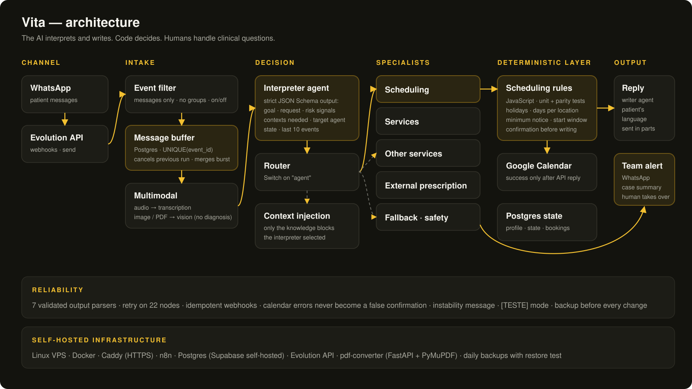
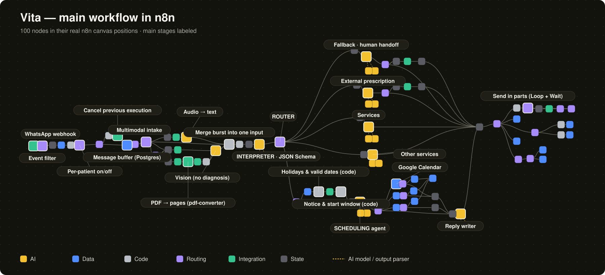

# 🩺 Vita — AI Receptionist on WhatsApp
#### Production multi-agent system · n8n · Postgres · OpenAI · self-hosted

**Status:** 🟢 In production · [](https://github.com/BaraoEverton/ai-conversational-systems/actions/workflows/ci.yml)

[](https://www.youtube.com/watch?v=VJTlh0OVKQI)

▶️ **[Watch the demo](https://www.youtube.com/watch?v=VJTlh0OVKQI)**: real WhatsApp conversations, scheduling, prescription reading and clinical handoff.

Vita answers patients on WhatsApp for clinics and professionals who depend on scheduling and fast, personalized service. It answers questions, books, reschedules and cancels appointments, reads audio, photos and PDFs, and hands cases to the human team with a ready summary.

It is not a canned-response bot. The architecture is fully customizable: services, rules, tone, notifications and internal flows are configured per business.

> This folder contains **sanitized exports** of the real workflows. Credentials, IDs, phone numbers, addresses, prices and personal data were replaced with placeholders. The logic, prompts and structure are intact.

---

## 🎯 What it solves

- Messages arriving after hours wait until the next morning
- Repeated questions take the team's time
- Bookings by chat create double entries and back-and-forth
- Clinical questions must never be answered by an automated system

---

## ⚙️ What it does

| Function | How |
|---|---|
| Questions & prices | Specialist agent with only the knowledge blocks the interpreter selected |
| Scheduling | AI interprets the request; **code decides** availability (holidays, locations, minimum notice, open slots) |
| Reschedule / cancel | Explicit confirmation state; success is only announced after the Google Calendar API responds |
| Memory | Conversation state + last 10 events; 12-hour window to decide greeting |
| Audio, photo, PDF | Transcription, vision model with no-diagnosis instruction, PDF → PNG pages via an own microservice |
| Human handoff | Clinical risk detected by the interpreter → team alert with case summary |
| Team control | On/off per patient and manual contact registration from an admin WhatsApp number |

---

## 🏗 Architecture



<details>
<summary>Text version</summary>

```
WhatsApp ─► Evolution API ─► n8n webhook
                               │
                               ├─ event filter (messages.upsert, not fromMe, not groups)
                               ├─ message buffer in Postgres (status: processing)
                               │    └─ a new message cancels the previous execution (n8n API)
                               │       and the last one merges the whole burst into one input
                               ├─ multimodal intake: audio → text · image → vision · PDF → pdf-converter → vision
                               │
                               ├─ INTERPRETER agent (strict JSON Schema output)
                               │    goal · request type · risk signals · required contexts · target agent
                               │
                               ├─ ROUTER (Switch on "agent")
                               │    ├─ SCHEDULING ──► scheduling subflow (JS rules + Google Calendar)
                               │    ├─ SERVICES
                               │    ├─ OTHER SERVICES
                               │    ├─ EXTERNAL PRESCRIPTION (reads document, confirms data, sends to team)
                               │    └─ FALLBACK (safety / human handoff)
                               │
                               └─ reply writer ─► replies split in parts (Loop + Wait) ─► WhatsApp
```

</details>

**The real workflow in n8n** (100 nodes, positions taken from the canvas):



**Custom context injection:** each specialist receives only the knowledge blocks chosen by the interpreter (`contextos_necessarios`), plus conversation state and recent history. Less noise, nothing invented.

---

## 🧪 Tested scheduling rules

The scheduling logic lives in two n8n Code nodes. It is also extracted into [`src/scheduling-rules`](src/scheduling-rules), a plain Node.js module with **17 unit tests** and a **parity test**: it runs the original node code from the exported workflow and checks that the module returns the same output in 300 random scenarios. CI runs on every push (Node 20 and 22).

## 🛡 Production conventions

- `outputParserStructured` ×7: every AI output is validated (`additionalProperties: false`, enums, required fields)
- `UNIQUE(event_id)` in Postgres: webhook resends are rejected (idempotency)
- `retryOnFail` on 22 nodes (DB, HTTP, agents) with 2–3 s waits
- Google Calendar errors handled with `continueRegularOutput`: the patient never receives a false confirmation
- Instability message offering the team if something fails
- Fixed timezone (`America/Sao_Paulo`) at workflow level
- `[TESTE]` mode for a test number: production testing without mixing data
- Backup before every production change; daily backups with restore test on the server

---

## 📊 Results (17 days of real operation)

- **36 s** median time to first response (current human service: ~10 min)
- **28 s** after hours (human: ~9 h)
- Infrastructure estimate: one server handles up to **~30,000 messages/day** (10 concurrent executions × ~28 s measured per message). The AI API limit depends on the plan.

---

## 📁 Contents

| Path | What it is | Status |
|---|---|---|
| `workflows/01-receptionist-main.json` | Main flow (100 nodes) | 🟢 Production |
| `workflows/02-scheduling-subflow.json` | Calendar lookup and slot rules | 🟢 Production |
| `workflows/03-admin-on-off.json` | Standalone admin menu (on/off per patient, contact list) | 🟡 Built, not yet active |
| `workflows/legacy/v1-google-sheets.json` | First version, Google Sheets as database | ⚪ Legacy (migrated to Postgres) |
| `src/scheduling-rules/` | Scheduling rules as a tested module (unit + parity tests, CI) | 🟢 Mirrors production |
| `docs/` | Architecture diagram and workflow map | 📘 Docs |
| `services/pdf-converter/` | FastAPI + PyMuPDF: PDF/image → PNG per page (`/convert`, `/convert-all`) | 🟢 Production |

---

## 🧰 Stack

n8n · OpenAI (LLM, vision, transcription) · Postgres (Supabase self-hosted) · Evolution API · Google Calendar API · FastAPI · PyMuPDF · Docker · Caddy · Linux VPS

---

## ▶️ Importing

1. In n8n: **Workflows → Import from file** and pick a JSON from `workflows/`
2. Create your own credentials (OpenAI, Postgres, Google Calendar, WhatsApp provider) and select them in the nodes marked `configure-in-your-n8n`
3. Replace placeholders (`YOUR_RESOURCE_ID`, `YOUR_INSTANCE`, `https://n8n.example.com`, knowledge-base texts) with your own values
4. Run `services/pdf-converter` with Docker on the same network as n8n

---

Built and operated end to end by **Everton Barão** — requirements, architecture, deployment and production reliability.
